Six infected, mutated animals that hunt players down: a T-Rex, an allosaurus, a raptor, a tiger, a thylacine and a bear. Each has its own specials, every limb (the head included) can be shot off, and every number is a yml setting. Made for Zombie Zone and usable in any GameSpice game (`games: ["*"]`). The addon is `addons/zz_historical_monsters`, built on dot-npc and dot-npc-ai.

### In GameSpice and Zombie Zone

- **GameSpice:** the pack is published to the Workshop as `zz-historical-monsters`. Add it to a server's or game's pack list and the six monsters appear in the spawn menu (NPC ids `zhm_trex`, `zhm_allosaurus`, `zhm_raptor`, `zhm_tiger`, `zhm_thylacine`, `zhm_bear`); players get it with the server's pack overlay, so there is nothing to install.
- **Zombie Zone:** link the pack into `addons/`. The game's pack scan (`game/zz_packs.gd`) finds `spawn_provider.gd` and adds each monster to the wave catalogue, with its brain seated by `game/zz_pack_brains.gd`; tune Zombie Zone's side in `cfg/addon/zombie_zone/*.yml`.
- **Playlot:** Playlot automatically places the pack's monsters into its spawn menu (`game/playlot_addons.gd` reads `spawn_provider.gd`), so you can test them there, or use the [Workbench](https://github.com/gamespice-platform/workbench) tool. Set the host meta `zhm_host` (see [Using it](#using-it)) to have their hits land on players.
- **Your own Godot game:** link `addons/zz_historical_monsters` beside dot-npc and dot-npc-ai and follow [Using it](#using-it).

| Monster | Specials (server-side, each warned before it lands) |
| --- | --- |
| T-Rex | roar (stuns everyone in range), tail sweep (everyone close), charge (locks a line, hits once, then staggers) |
| Tiger | pounce (a locked leap that lands on whoever is still there) and a stacking bleed that outlives the fight |
| Allosaurus | as the T-Rex, slower and heavier |
| Raptor | as the T-Rex, fast and light |
| Thylacine | as the tiger: pounce and bleed |
| Bear | maul (a three-swing combo) and ground slam (stuns, weaker with distance) |

<!-- gen_readme:summary -->
| | Monster | Role | Health | Damage | Weight |
| --- | --- | --- | --- | --- | --- |
|  | [Infected T-Rex](#infected-t-rex) | Boss | 2200 | 45 bite | Boss |
| <a href="#infected-allosaurus">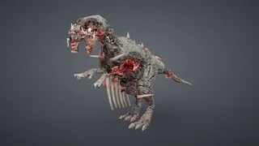</a> | [Infected Allosaurus](#infected-allosaurus) | Heavy brawler | 1100 | 34 bite | Heavy |
| <a href="#infected-raptor">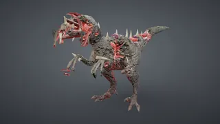</a> | [Infected Raptor](#infected-raptor) | Fast hunter | 380 | 16 bite | Normal |
| <a href="#infected-tiger">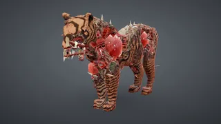</a> | [Infected Tiger](#infected-tiger) | Ambusher | 520 | 14 claw | Normal |
| <a href="#infected-thylacine">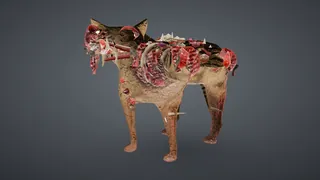</a> | [Infected Thylacine](#infected-thylacine) | Skirmisher | 330 | 11 claw | Normal |
| <a href="#infected-bear">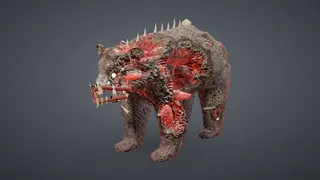</a> | [Infected Bear](#infected-bear) | Heavy bruiser | 1100 | 3 x 13 maul | Heavy |
<!-- /gen_readme:summary -->

## Using it

- Spawn menu: `addons/zz_historical_monsters/spawn_provider.gd` has a static `spawn_entries()`. Each entry's `spawn` is `{health, speed, damage, reach, body, boss?}`.
- Damage: the monsters report to a host through `zhm_targets()`, `zhm_hit(npc, victim, amount, kind, info)` and `zhm_status(victim, status, seconds, info)`. Give the host as the spawner's meta `zhm_host` (or `ZhmRuntime.host`). Without one, monsters still chase, and their hits are recorded and signalled (`ZhmHost`).
- Logging goes through `DotLog` on `zhm.*` channels.

<!-- gen_readme:items -->
## The monsters

### Infected T-Rex

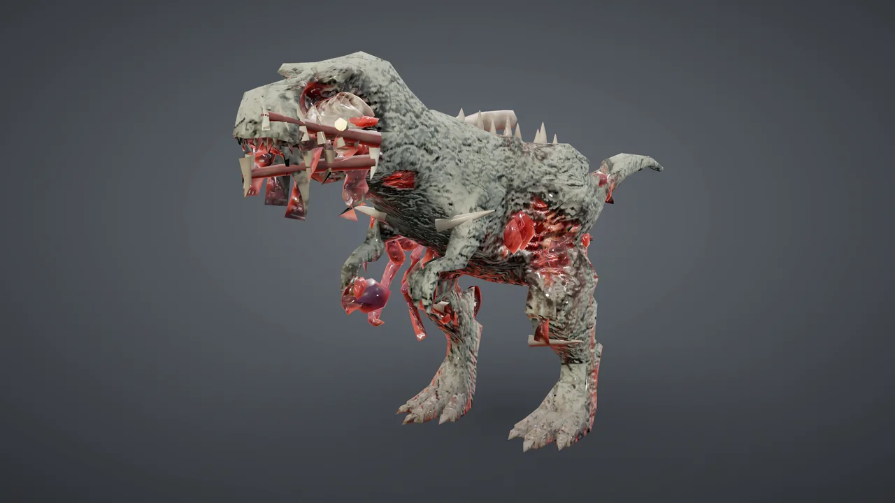

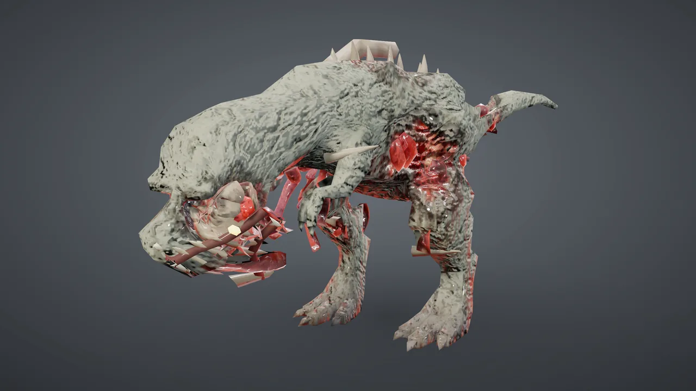

*Bite: the heaviest single hit in the pack.*

**Boss** `trex`. The set piece. Slow to turn but huge, it roars to stun and slow everyone in range, sweeps its tail at anyone who gets close, and locks a line for a charge that hits once and then leaves it staggered. Its jaw and short arms can be shot off; the head kills it.

| Default | |
| --- | --- |
| Health | 2200 |
| Speed | 3.2 m/s walking, 6 m/s running |
| Bite | 45 damage, 4.2 m reach, every 1.8 s (0.45 s windup) |
| Roar | stuns 2.5 s and slows to 50 % within 16 m; 16 s cooldown (1 s windup) |
| Tail sweep | 32 damage within 6.5 m, knockback 10; 7 s cooldown (0.8 s windup) |
| Charge | 65 damage, knockback 14, at 13 m/s from 10 to 32 m; 13 s cooldown (1.1 s windup) |
| Sight | 45 m, 140 deg cone |
| Hearing | 30 m |
| Weight class | Boss |
| Spawn cost | 12 |
| Body | 5 m tall, 1.1 m radius |
| Shootable limbs | head 320 (kills), armL 100, armR 100, legL 450, legR 450, tail 220 |

### Infected Allosaurus

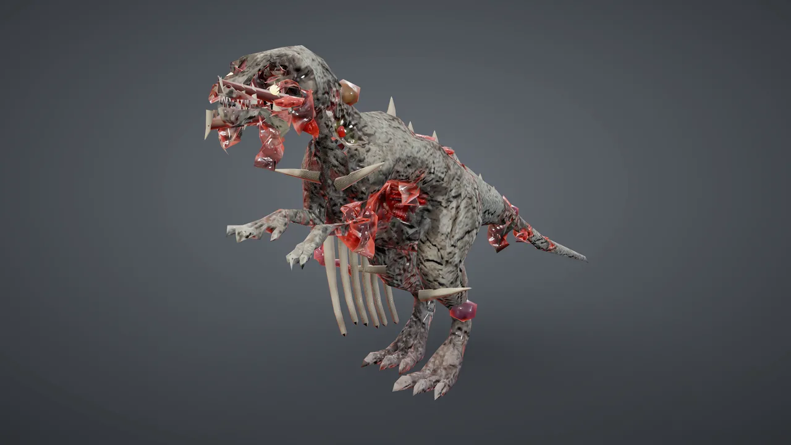

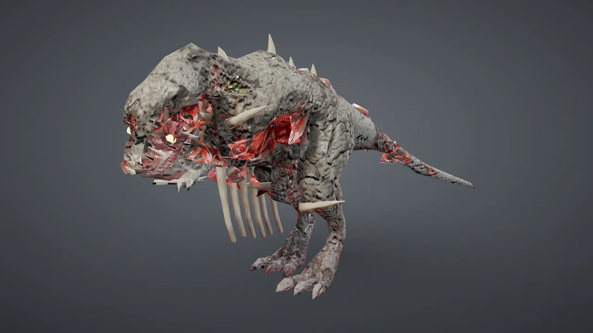

*Bite: the jaws drive forward and snap shut.*

**Heavy brawler** `allosaurus`. The T-Rex's kit on a slower, heavier frame: bite, roar, tail sweep and charge. Good as a mini-boss or a second big threat in a horde.

| Default | |
| --- | --- |
| Health | 1100 |
| Speed | 3.4 m/s walking, 8 m/s running |
| Bite | 34 damage, 3.4 m reach, every 1.5 s (0.4 s windup) |
| Roar | stuns 2 s and slows to 60 % within 14 m; 18 s cooldown (0.9 s windup) |
| Tail sweep | 24 damage within 5 m, knockback 8; 7 s cooldown (0.7 s windup) |
| Charge | 48 damage, knockback 11, at 12 m/s from 8 to 28 m; 11 s cooldown (0.9 s windup) |
| Sight | 42 m, 140 deg cone |
| Hearing | 30 m |
| Weight class | Heavy |
| Spawn cost | 8 |
| Body | 3.4 m tall, 0.85 m radius |
| Shootable limbs | head 240 (kills), armL 80, armR 80, legL 340, legR 340, tail 170 |

### Infected Raptor

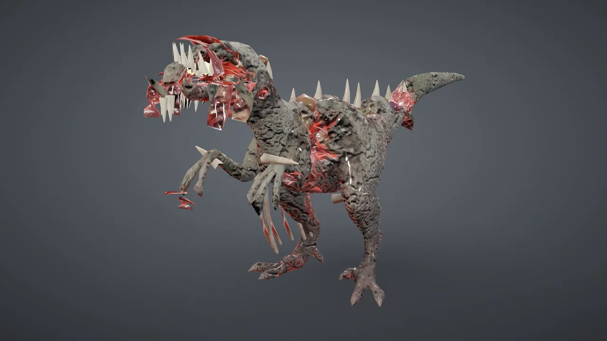

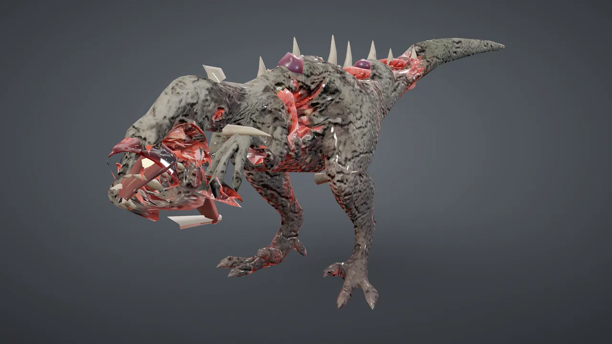

*Bite: fast, low and from the flank.*

**Fast hunter** `raptor`. Light and quick, with the same specials as the big theropods. Raptors close distance fast and punish players who stand in the open.

| Default | |
| --- | --- |
| Health | 380 |
| Speed | 3.8 m/s walking, 10 m/s running |
| Bite | 16 damage, 2 m reach, every 0.9 s (0.25 s windup) |
| Roar | stuns 1 s and slows to 70 % within 10 m; 20 s cooldown (0.7 s windup) |
| Tail sweep | 10 damage within 2.6 m, knockback 5; 6 s cooldown (0.5 s windup) |
| Charge | 24 damage, knockback 6, at 15 m/s from 6 to 22 m; 7 s cooldown (0.6 s windup) |
| Sight | 40 m, 150 deg cone |
| Hearing | 30 m |
| Weight class | Normal |
| Spawn cost | 4 |
| Body | 1.9 m tall, 0.5 m radius |
| Shootable limbs | head 110 (kills), armL 50, armR 50, legL 130, legR 130, tail 70 |

### Infected Tiger

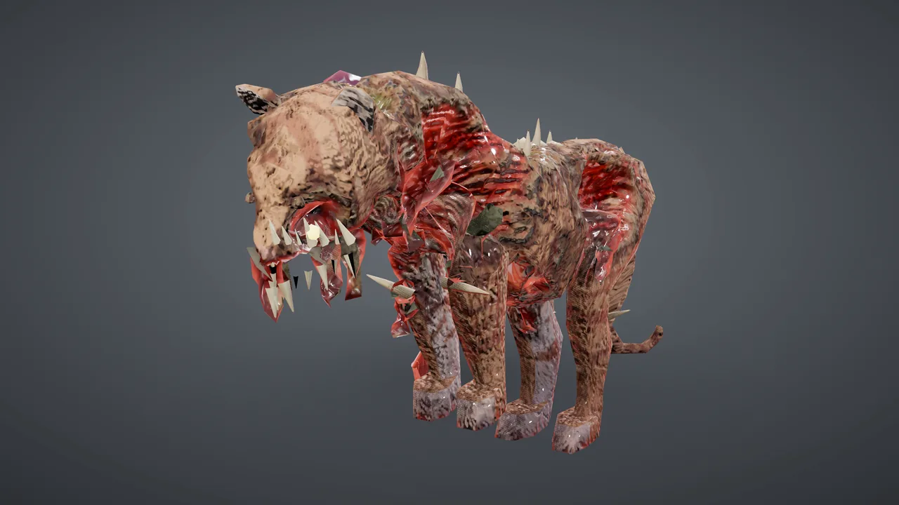

*Pounce windup: crouched and locked on.*

**Ambusher** `tiger`. Stalks low, then pounces: the leap locks on a spot and lands on whoever is still there. Its claws leave a bleed that stacks and keeps ticking after the fight.

| Default | |
| --- | --- |
| Health | 520 |
| Speed | 3.6 m/s walking, 9.5 m/s running |
| Claw | 14 damage, 2 m reach, every 0.8 s (0.25 s windup) |
| Bleed | 4 damage per second for 6 s, stacks up to 3 |
| Pounce | 24 damage, leaps from 4 to 16 m at 17 m/s; 6 s cooldown (0.6 s windup) |
| Sight | 38 m, 160 deg cone |
| Hearing | 28 m |
| Weight class | Normal |
| Spawn cost | 4 |
| Body | 1.7 m tall, 0.55 m radius |
| Shootable limbs | head 110 (kills), foreL 70, foreR 70, hindL 80, hindR 80, tail 40 |

### Infected Thylacine

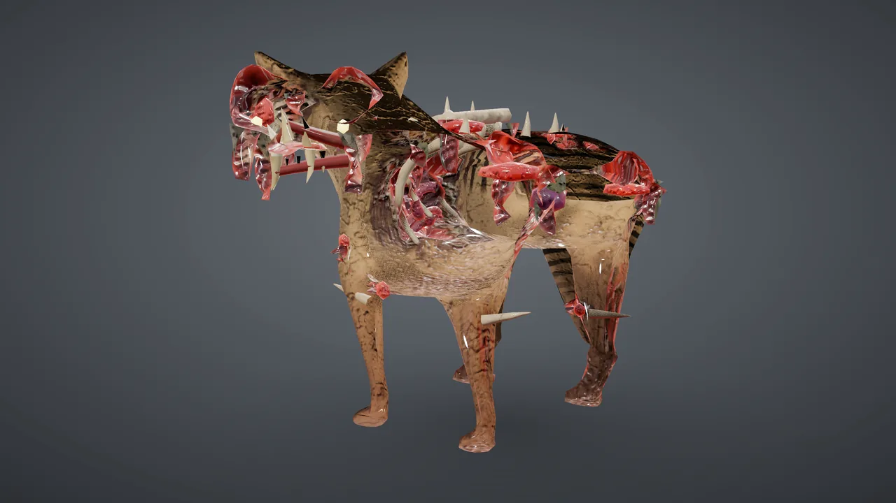

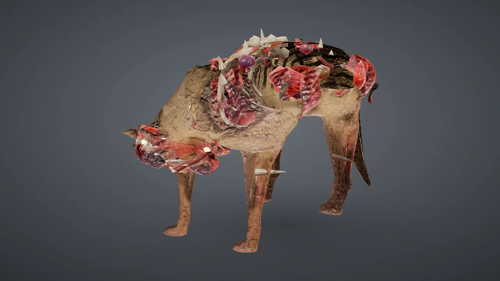

*Bite.*

**Skirmisher** `thylacine`. A smaller, faster cousin of the tiger with the same pounce and stacking bleed. Cheap to spawn, so it comes in numbers.

| Default | |
| --- | --- |
| Health | 330 |
| Speed | 3.4 m/s walking, 9 m/s running |
| Claw | 11 damage, 1.8 m reach, every 0.8 s (0.25 s windup) |
| Bleed | 3 damage per second for 6 s, stacks up to 3 |
| Pounce | 18 damage, leaps from 3.5 to 14 m at 15 m/s; 6 s cooldown (0.6 s windup) |
| Sight | 36 m, 160 deg cone |
| Hearing | 30 m |
| Weight class | Normal |
| Spawn cost | 3 |
| Body | 1.3 m tall, 0.45 m radius |
| Shootable limbs | head 90 (kills), foreL 60, foreR 60, hindL 70, hindR 70, tail 35 |

### Infected Bear

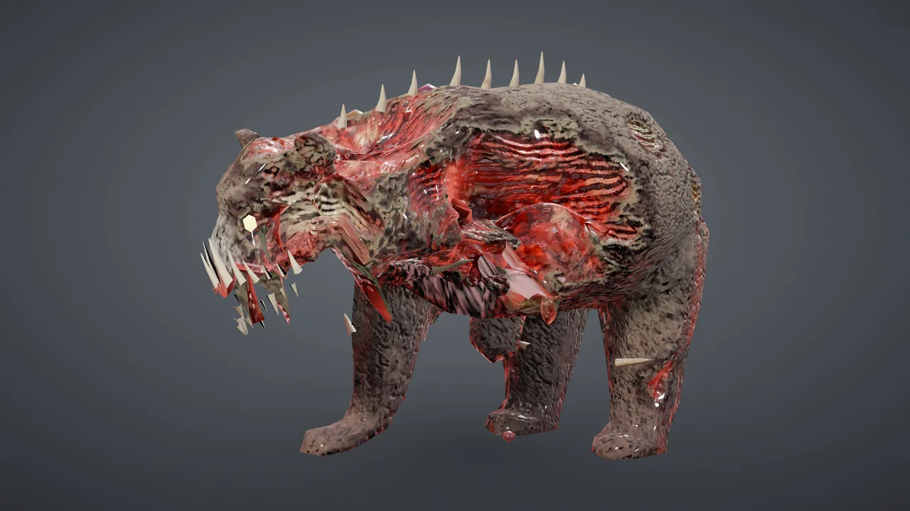

*Maul: a raking swipe at close range.*

**Heavy bruiser** `bear`. Rears up, then mauls with a three-swing combo, or slams the ground to stun and knock back everyone nearby (weaker with distance). Slow, tough and hard to stagger.

| Default | |
| --- | --- |
| Health | 1100 |
| Speed | 3.4 m/s walking, 7.5 m/s running |
| Maul | 3 hits of 13 damage, 0.45 s apart, 2.6 m reach, every 1.4 s (0.3 s windup) |
| Slam | 30 damage within 5.5 m, stuns 1.2 s, knockback 7; 9 s cooldown (0.95 s windup) |
| Sight | 32 m, 150 deg cone |
| Hearing | 26 m |
| Weight class | Heavy |
| Spawn cost | 6 |
| Body | 2 m tall, 0.8 m radius |
| Shootable limbs | head 220 (kills), armL 160, armR 160, legL 180, legR 180 |
<!-- /gen_readme:items -->

## Settings

Every number is in `cfg/addons/zz_historical_monsters/<name>.yml`, one file per species (`trex`, `tiger`, `bear`, `raptor`, `allosaurus`, `thylacine`). A missing file or key falls back to the defaults in `core/zhm_config.gd`.

## Shooting off limbs

Each species lists its `limbs:` in its yml:

| Key | Meaning |
| --- | --- |
| `bones`, `tip`, `radius` | The region: the line through the bones plus `tip` metres, `radius` thick |
| `health` | Damage the limb takes before it comes off |
| `kills` | On the head: losing it ends the monster |
| `slow`, `attack` | Multipliers on speed and damage once the limb is gone |

A game's shot code calls `body.zhm_limb_hit(world_point, damage, impulse)` on the server, beside the damage it does to the monster. It returns the limb that came off, or `&""`. The limb's stump collapses, the cut drips, and the limb tumbles away as a gib with a blood burst. Which limbs are gone replicates as `net_limbs`, one bit per limb in config order. The machinery is dot-npc's `DotNpcLimbs` and `DotNpcGibs`; see [docs/limb-hook-design.md](docs/limb-hook-design.md).

## Networking

Monsters are decided by the server. `ZhmNetSync` (`core/zhm_net_sync.gd`) lists what goes over the wire as plain data and never names dot-net. The host's net behaviour declares one field per `ZhmNetSync.specs()` entry, calls `pull(npc, body, self)` on the server each tick, and on a client builds the body with `make_mirror(net_species)` and calls `apply(body, self)`. `examples/zhm_net_behaviour.gd` is the whole wiring.

## Testing

`./game.sh test` runs the parse pass and the suites `zhm_selftest`, `zhm_net` and `zhm_shoot`. `tools/screenshot.sh --all` renders every monster (set `GPU_OFFLOAD=0` to render locally).

<!-- gen_readme:quality -->
## Quality and ongoing improvement

The models, textures, sounds and animations in this pack are being improved over time, and some of them are low quality today. Improvement is driven by the Nightly queue, a work queue where agents pick up items, and by a visual judge loop that views rendered frames and files defects until each asset passes repeated clean reviews. Known defects are filed there and fixed in later releases, and the screenshots in this README are regenerated as the assets improve.
<!-- /gen_readme:quality -->

## Credits

Every shipped model is a modified build product of the sources in `art-src/base/`, made by `tools/build_monsters.py` (Blender, headless): recoloured and wounded, with ribs, spurs, teeth and glowing eyes, decimated for the web. Textures are baked PNGs beside each `.glb`. Sketchfab "Free Standard" models are not used, because that is not a Creative Commons licence. Details and change notes are in [CREDITS.md](CREDITS.md). The code is MIT, see [LICENSE](LICENSE).

| Monster | Base model | Author | Licence | Source |
| --- | --- | --- | --- | --- |
| T-Rex | T-Rex | Quaternius | CC0 1.0 | [Poly Pizza](https://poly.pizza/m/UYtneO5FpF) |
| Tiger | Tiger | Poly by Google | CC BY 3.0 | [Poly Pizza](https://poly.pizza/m/5A3w06FXUup) |
| Bear | Black bear | Poly by Google | CC BY 3.0 | [Poly Pizza](https://poly.pizza/m/56ym_pyVnel) |
| Raptor | Velociraptor (reuploaded and retextured) | seth the yutyrannus | CC BY 4.0 | [Sketchfab](https://sketchfab.com/3d-models/velociraptor-reuploaded-and-retextured-def52bae17f749b0b911a695fdb05218) |
| Allosaurus | Allosaurus | seth the yutyrannus | CC BY 4.0 | [Sketchfab](https://sketchfab.com/3d-models/allosaurus-02e651e39fed47bbaec0aa0546f17fd3) |
| Thylacine | wolf (a Tasmanian wolf, striped) | victory_mirosya | CC BY 4.0 | [Sketchfab](https://sketchfab.com/3d-models/wolf-c5c2c9b77df94d758e732237a7d98af0) |
